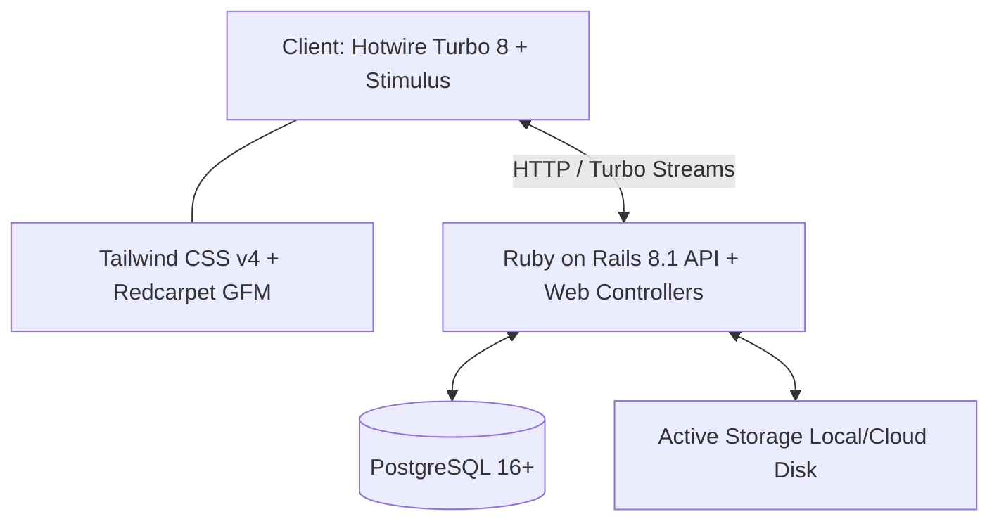

# Doer

<p align="center">
  <strong>A local-first markdown todoing tool and workspace for developers.</strong>
</p>

<p align="center">
  <a href="https://ruby-lang.org"></a>
  <a href="https://rubyonrails.org"></a>
  <a href="https://hotwired.dev"></a>
  <a href="https://tailwindcss.com"></a>
  <a href="https://www.postgresql.org"></a>
  
</p>

---

## Overview

**Doer** is a dedicated, distraction-free desktop todoing and checklist workbench designed to run locally. It allows you to organize, author, preview, and track todo lists grouped by project or kept as standalone scratchpads—with interactive preview checkboxes, instant one-click markdown copying, live split-screen previewing, drag-and-drop context file attachments, and pinned list management.

---

## Key Features

### 📁 Project & Standalone Organization
- **Structured Hierarchy**: Organize todo lists inside dedicated projects (e.g., `Personal`, `Sprint Goals`, `Product Launch`, `Refactoring`).
- **Standalone Lists**: Keep loose scratchpad todo lists without forcing project assignment.
- **Fluid Assignment**: Reassign any list to any project or back to standalone anytime via a quick dropdown.
- **Real-Time Search**: Instant client-side todo list and project filtering from the persistent sidebar.

### 📝 Markdown Checklists with 3 View Modes
- **Preview Mode**: Clean GitHub Flavored Markdown (GFM) rendering with interactive task checkboxes (`- [ ]` / `- [x]`). Toggling checkboxes in Preview mode updates the markdown source and triggers auto-save.
- **Edit Mode**: Monospaced raw Markdown editor with debounced auto-save and visual save status indicators.
- **Split Mode**: Side-by-side split screen providing live editor feedback alongside real-time rendered markdown.
- **Save Shortcut**: `⌘S` / `Ctrl+S` instant save from anywhere in the editor.

### ⚡ Zero-Latency One-Click Copy
- **Workspace Toolbar**: Prominent `Copy Markdown` button on the list workspace header.
- **List Cards**: Quick `Copy` action directly on every card in project and index listings.
- **Immediate Feedback**: Instant visual cue transitioning to `Copied!` with highlight styling.

### 📌 Pinned Lists & Reordering
- **Sidebar Quick Access**: Pin your most critical todo lists to the top of the sidebar.
- **Drag-and-Drop Reordering**: Smooth client-side reordering persisted to the database via `pinned_position`.
- **Global Toggle**: Quick-pin or unpin lists directly from cards or detail toolbars.

### 📎 ActiveStorage Dropzone Context Attachments
- **Drag-and-Drop Uploads**: Direct ActiveStorage file uploads with drag-and-drop dropzones on list pages without full-page reloads.
- **Rich Attachment Previews**: Image thumbnail rendering, formatted human-readable file sizes, download links, and instant attachment purging via Turbo Streams.

### 🖥️ Collapsible Workspace & Mobile Ergonomics
- **Collapsible Sidebar**: Toggle with `⌘\` / `Ctrl+\` or via the top-bar button.
- **Responsive Layout**: On mobile, views smoothly switch between list navigation and full-screen editor views.

---

## Architecture & Tech Stack



- **Backend**: Ruby 3.4+, Rails 8.1+
- **Frontend**: Hotwire (Turbo 8 + Stimulus), Tailwind CSS v4, Redcarpet GFM
- **Database**: PostgreSQL 16+
- **Attachments**: Active Storage (Local / Disk / S3 compatible)
- **API**: Comprehensive RESTful JSON API with OpenAPI 3.1 specification at `/api/v1/openapi`

---

## Getting Started

### Prerequisites
- Ruby 3.4+
- PostgreSQL 16+
- Bundler

### Installation

1. **Clone the repository**:
   ```bash
   git clone https://github.com/leouofa/doer.git
   cd doer
   ```

2. **Install Ruby dependencies**:
   ```bash
   bundle install
   ```

3. **Database Setup**:
   ```bash
   bin/rails db:create
   bin/rails db:schema:load
   ```

4. **Start the development server**:
   ```bash
   bin/dev
   ```
   Open [http://localhost:3000](http://localhost:3000) in your browser.

---

## REST API Overview

Doer provides a complete JSON API under `/api/v1/`:

- `GET /api/v1/todo_lists` - List todo lists (supports `?scope=standalone`, `?project_id=ID`, `?pinned=true`, `?q=query`)
- `POST /api/v1/todo_lists` - Create a new todo list
- `GET /api/v1/todo_lists/:id` - Get todo list details (`?render_markdown=true`)
- `PATCH /api/v1/todo_lists/:id` - Update a todo list
- `DELETE /api/v1/todo_lists/:id` - Delete a todo list
- `PATCH /api/v1/todo_lists/:id/toggle_pin` - Toggle pinned state
- `PATCH /api/v1/todo_lists/reorder_pinned` - Reorder pinned lists (`{ todo_list_ids: [...] }`)
- `GET /api/v1/todo_lists/:id/attachments` - List attachments
- `POST /api/v1/todo_lists/:id/attachments` - Upload attachments
- `DELETE /api/v1/todo_lists/:id/attachments/:attachment_id` - Purge attachment
- `GET /api/v1/projects` - List projects
- `POST /api/v1/projects` - Create a project
- `GET /api/v1/projects/:id` - Get project with its todo lists
- `GET /api/v1/stats` - Platform statistics
- `POST /api/v1/markdown/render` - Render and sanitize arbitrary markdown
- `GET /api/v1/openapi` - Complete OpenAPI 3.1.0 specification
